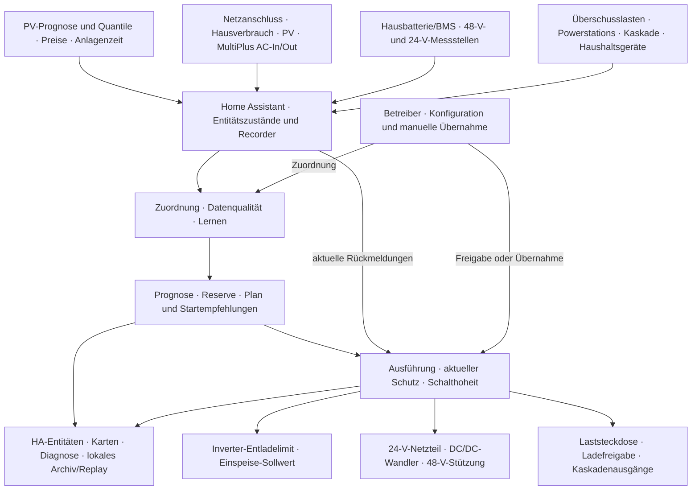

# Battery Manager · Anforderungsspezifikation

**Fassung 1.1 · 28. November 2026.** Der Betreiber hat die drei Entscheidungen zum 24-V-Quellenwechsel, zur Herkunft der Aktorrückmeldung und zum erneuten Export nach einem Schutzstopp verbindlich freigegeben. Die fachliche Freigabe der übrigen Gesamtausgabe steht aus. Bezugsstände der Umsetzung sind weiterhin `v0.70.0` (`4bc96b1`) und der gesicherte lokale Stand mit Manifestversion `0.71.0`. [Freigaben und Standortnachweis](abnahme.md#entscheidungen-für-den-betreiber)

## Zweck, Beteiligte und Grenzen

Der Betreiber will den Haushalt zuverlässig mit Energie versorgen, die Batterie innerhalb ihrer Betriebsgrenzen betreiben und verbleibenden Solarstrom sinnvoll nutzen. Der Battery Manager plant für den verfügbaren Prognosehorizont. Er kann Empfehlungen anzeigen und konfigurierte Aktoren führen. Die Ausführung prüft die Freigabe anhand der aktuellen Anlage erneut. Eine planbare Waschmaschine, ein schlafender Speicher und ein zurzeit abgesteckter Entfeuchter benötigen deshalb unterschiedliche Regeln.

| Wer liest das Dokument? | Wofür? |
|---|---|
| Betreiber | Verstehen, wann ein Gerät laufen darf, welche Einstellung das bewirkt und wann er die Schalthoheit hat. |
| Einrichter | Messstellen, Einheiten, Versorgungswege und Aktoren der eigenen Anlage zuordnen. |
| Fachprüfer und Entwickler | Einen Vertrag bis zur Betreiberentscheidung, Vorgängerregel und einem konkreten Prüffall zurückverfolgen. |
| Instandhalter | Nach Neustart oder Störung erklären, ob ein Plan, ein Schaltauftrag oder eine belastbare Geräterückmeldung vorlag. |

Die Systemgrenze umfasst die Home-Assistant-Integration, ihren Planer, die mitgelieferten Karten und die lokalen Auswertungen ihrer Aufzeichnungen. Home Assistant liefert Zeit, Zustände, Verlauf und Dienstausführung. Die Geräte liefern ihre eigenen Rückmeldungen. PV-Prognoseanbieter, Preisquelle, Gerätesteuerungen und BMS arbeiten außerhalb des Battery Managers. Eine Gerätequittung kann Schaltbereitschaft belegen. Ob ein Netzteil tatsächlich Energie geliefert hat, hängt von der verfügbaren Messung und deren Messgrenze ab.

Ein automatischer Auftrag ist nur für einen vorhandenen, zugeordneten und vom Manager geführten Aktor möglich. Der Nutzer eines Haushaltsgeräts startet dessen Programm selbst. Konkrete Gerätebezeichnungen im Text veranschaulichen eine mögliche Installation.

## Kapitel

| Kapitel | Leitfrage |
|---|---|
| [1 · Anlage und Konfiguration](01-anlage.md) | Welche Anlage kann ich abbilden? Was bleibt beim Ändern und Migrieren erhalten? |
| [2 · Signale und Datenqualität](02-signale.md) | Was misst ein Sensor, wann ist sein Wert gültig und wann ist sein Ausfall erwartbar? |
| [3 · Lernen, Prognose und Planung](03-planung.md) | Wie entstehen Energiebedarf, Nachtprognose, Reserven und zeitlich begrenzte Buchungen? |
| [4 · Energieflüsse und sichere Steuerung](04-energie.md) | Wer darf bei Netzwechsel, niedrigem SOC oder manueller Übernahme welchen Auftrag erteilen? |
| [5 · Verbraucher und Programme](05-verbraucher.md) | Wann ist eine Last planbar, ein Speicherpfad ausführbar oder ein Haushaltsprogramm tatsächlich aktiv? |
| [6 · Bedienung, Schnittstellen und Betrieb](06-betrieb.md) | Wie bediene, beobachte und prüfe ich die Anlage und ihre Aufzeichnung? |
| [Quellenregister](quellen.md) und [Abnahme](abnahme.md) | Woher kommt die jeweilige Regel, welche Konflikte sind geklärt und was ist noch zu entscheiden? |

## Betriebsarten und Schalthoheit

- **Empfehlung.** Der Manager veröffentlicht eine geplante Aktion. Ohne zugehörigen automatisch geführten Aktor liegt die physische Umsetzung beim Betreiber oder seiner HA-Automation.
- **Automatische Laststeuerung.** Bei zugeordneten Aktoren und aktiver Gerätesteuerung prüft der Manager Bedarf, Geräteverfügbarkeit, Besitz und Schutzbedingungen vor der Ausführung. Kaskaden haben einen gemeinsamen Controller für ihren elektrischen Pfad.
- **Koordinierte Versorgung.** Der Manager stimmt Inverter-Entladelimit, DC/DC-Wandler und vorhandene Netzteile ab. Bei Netzrückkehr, ungeklärten Zuständen und Wiederanlauf gelten die jeweiligen Übergabebedingungen. Auch bei älteren Anlagen ohne koordinierten Inverteraktor gelten für den automatischen Wechsel zwischen zwei schaltbaren 24-V-Quellen dieselben Bestätigungs- und Überlappungsregeln.
- **Reservemodus.** `off`, `shadow` und `active` wählen die Wirkung der Reservepolitik. Im Schattenbetrieb ist die Reserveberechnung beobachtbar, der Vergleichsbetrieb bestimmt die Ausführung. Die Wahl gilt für die Reservepolitik. Andere aktive Steuerpfade haben ihre eigenen Freigaben. [Reservevertrag](../F-YEAR-ROUND-RESERVE.md)
- **Manuelle Übernahme.** Eine bestätigte Übergabe betrifft die bezeichneten Aktoren. Bei koordinierter 24-V-Übergabe umfasst sie Netzteil und DC/DC-Wandler. Die manuelle 48-V-Übergabe betrifft das 48-V-Netzteil. Der Modus und die Übergabe zurück an die Automatik sind getrennte Vorgänge. [Versorgungsvertrag](../F-COORDINATED-DC-SUPPORT.md)

## Drei Beispiele aus Sicht des Betreibers

| Installation | Bei ausbleibendem Messwert | Bei einer neuen Meldung |
|---|---|---|
| Entfeuchter mit direkt versorgtem Kellerfühler | Ist der Fühler als bindende Verfügbarkeit oder als Pflicht-Leistungsmesser eingerichtet, fällt der Entfeuchter aus der planbaren Menge. Im Winter kann er so abgesteckt bleiben. | Bestätigte 0 W bestehen die Leistungsmesspflicht. Ob der Entfeuchter laufen soll, bestimmt dann der Plan. [Verfügbarkeit](05-verbraucher.md#bm-last-001) |
| Waschmaschine mit Matter-Messstecker hinter der geschalteten Steckdose | Bestätigtes AUS an der zugeordneten vorgeschalteten Steckdose erklärt die Messlücke. Eine Unterbrechung beendet keinen Lauf erfolgreich. | Nach EIN belegt erst eine aktuelle Beobachtung den neuen Lauf. Das Programm startet der Bediener. [Versorgungsevidenz](05-verbraucher.md#bm-last-062) |
| Schlafender Fossibot | Ohne konfigurierte Pflichtmessung kann ein gültiger letzter SOC derselben Bindung die befristete Planung ermöglichen. | Der zuständige Ladepfad prüft beim Aufwecken die aktuellen Signale, bevor er zur nächsten Schaltstufe übergeht. [Schlafender Speicher](05-verbraucher.md#bm-last-032) · [Aufwecken](05-verbraucher.md#bm-last-040) |

## Begriffe, die über eine Freigabe entscheiden

| Begriff | Bedeutung im Dokument |
|---|---|
| **Verfügbar** | Für die genannte Funktion ist deren Voraussetzung erfüllt. Ein erreichbarer Sensor, eine planbare Last und ein ausführbarer Schaltpfad sind drei unterschiedliche Aussagen. |
| **Bestätigt** | Eine der Bindung und dem Vorgang zuordenbare Rückmeldung erfüllt die für diese Rolle festgelegten Qualitätskriterien. Diensterfolg ist keine physische Bestätigung. |
| **Freigegeben** | Die betreffende Aktion ist nach den gegenwärtig anwendbaren Regeln zulässig. Die Freigabe sagt noch nichts über den Versand oder die Ausführung des Auftrags. |
| **Schalthoheit** | Berechtigung, für den konkreten Aktor einen neuen Auftrag zu erteilen. Ein beobachtetes EIN begründet für sich allein keinen Besitz. |
| **Aktives Programm** | Das Gerät meldet, welches Programm dem laufenden Durchgang zugeordnet ist. Eine Auswahl wie „Eco“ im stillstehenden Gerät beschreibt eine Vorschau. Die Erkennung eines laufenden Durchgangs hat eigene Kriterien. |
| **SOC** | Ladezustand eines bestimmten Speichers in Prozent. Unterschiede werden in Prozentpunkten angegeben. Gemessener BMS-SOC, Sicherheitskurve und erwartete Betriebskurve sind gesonderte Größen. |
| **Restlast und Reserve** | Die AC-Restlast ist ein momentaner Leistungsbedarf in W. Die Reserve ist zurückgehaltene Energie für erwartete Versorgung. Ein Restlastmesswert allein begründet keine zusätzliche Entladeenergie. |
| **Nullwert und Messlücke** | Bestätigte 0 W sind ein Leistungswert. Eine fehlende, ungültige oder für den Zweck zu alte Messung liefert keinen Zahlenwert. Ein Sollwert von 0 W ist ein Auftrag am zugeordneten Stellglied. |

## Wie eine Anforderung gelesen und gepflegt wird

Jede Tabellenzeile enthält eine dauerhafte ID, einen fachlichen Satz, ein beobachtbares Abnahmekriterium, die Quelle, zwei unabhängige Statusangaben und den Nachweis. Das Ziel und die Beteiligten stehen beim jeweiligen Abschnitt. Ein Standortbeispiel begründet keine allgemeine Hardwarepflicht. Nummern bleiben bei Überarbeitung erhalten. Entfallen Anforderungen, erhält das Register den Verweis auf Nachfolge oder Rücknahme.

| Feld | Bedeutung |
|---|---|
| **F · Fachlicher Ursprung/Freigabe** | **B** = aus einem verbindlichen Fachvertrag übernommen oder vom Betreiber ausdrücklich freigegeben. **I** = aus beobachtbarem Verhalten rekonstruiert, fachliche Validierung ausstehend. **E** = vorgeschlagener oder in Klärung befindlicher Vertrag. Für eine neu erteilte Freigabe nennt das Entscheidungsprotokoll Anlass und Umfang. Die formale Freigabe der neuen Gesamtfassung wird im Abnahmedokument geführt. |
| **U · Umsetzung** | **R** = Umsetzung dem Bezugsrelease zugeordnet. **L** = im lokalen Nachfolgestand vorhanden. **T** = bekannte Teilumsetzung oder Abweichung. **?** = Umsetzung noch offen oder nicht festgestellt. R und L benennen einen Stand, kein erfolgreiches Prüfergebnis. |
| **Nachweis** | Benannter Test = vorhandener Prüffall für die genannte Aussage. „Teilnachweis“ bzw. „Prüffall offen“ grenzt die belegte Aussage ein. Bei Inspektion ist die zu prüfende Fundstelle angegeben. Tatsächlich durchgeführte Prüfungen und deren Stand stehen in der Abnahme. |

Die Redaktionsregeln orientieren sich an ISO/IEC/IEEE 29148, dem INCOSE *Guide to Writing Requirements* und dem IREB-Lehrstoff. Jede normative Aussage soll für ihren Adressaten verständlich sein und sich unabhängig widerlegen lassen. Grenzwerte stammen aus einem belegten Vertrag. Prüfbedingungen, Beispiele und Entwurfsentscheidungen stehen außerhalb des Anforderungssatzes. Bei fachlichen Änderungen gilt **Spezifikation → Design → Implementierung**. [ISO/IEC/IEEE 29148](https://www.iso.org/standard/72089.html) · [INCOSE, Guide to Writing Requirements v4](https://www.incose.org/wp-content/uploads/legacy/working-groups/requirements-wg/guidetowritingrequirements/incose_rwg_gtwr_v4_summary_sheet.pdf) · [IREB Foundation Level](https://cpre.ireb.org/en/process/level-1) · [Projektregeln](../../AGENTS.md)
